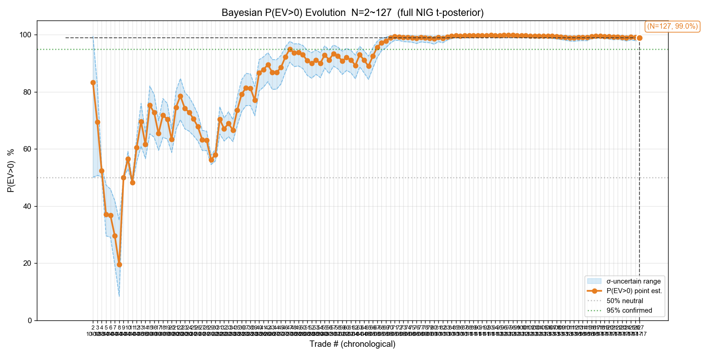
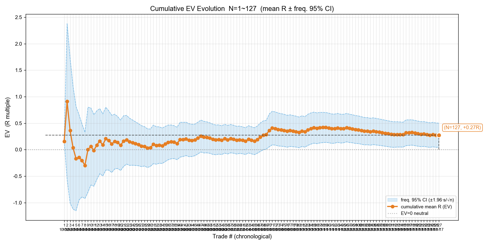
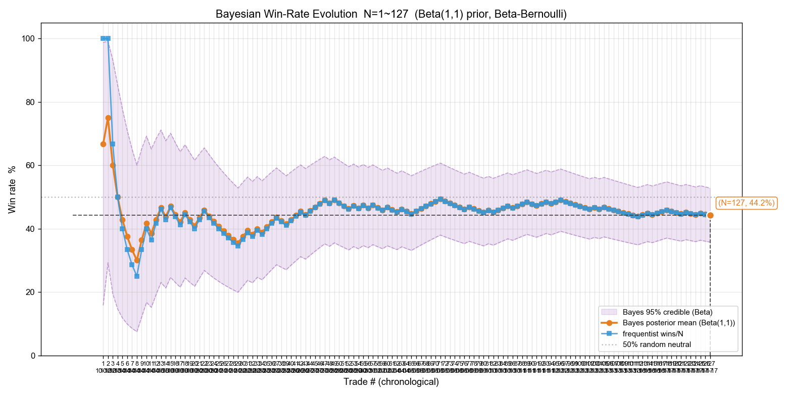
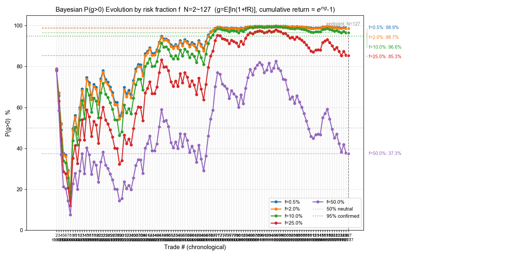
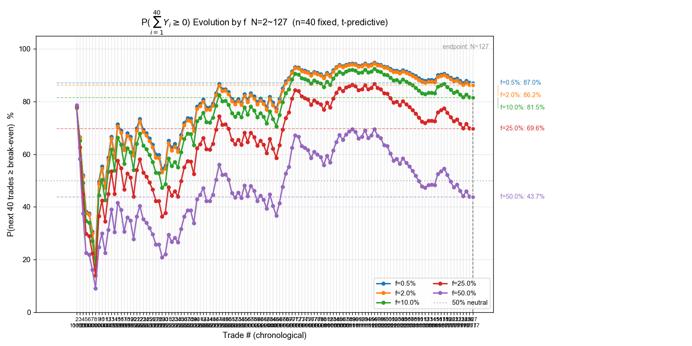
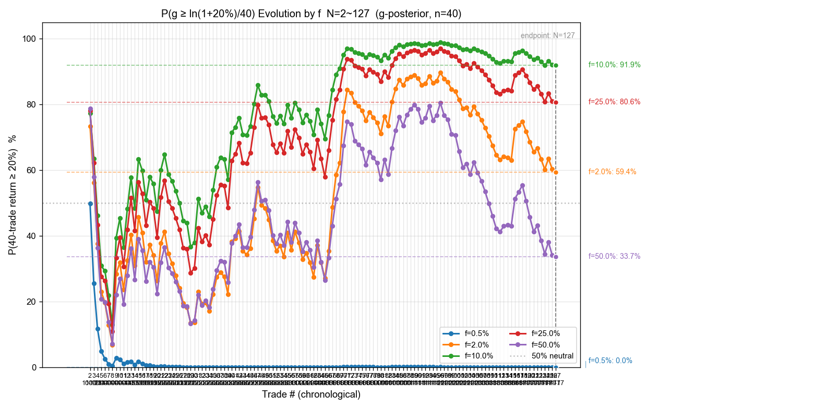
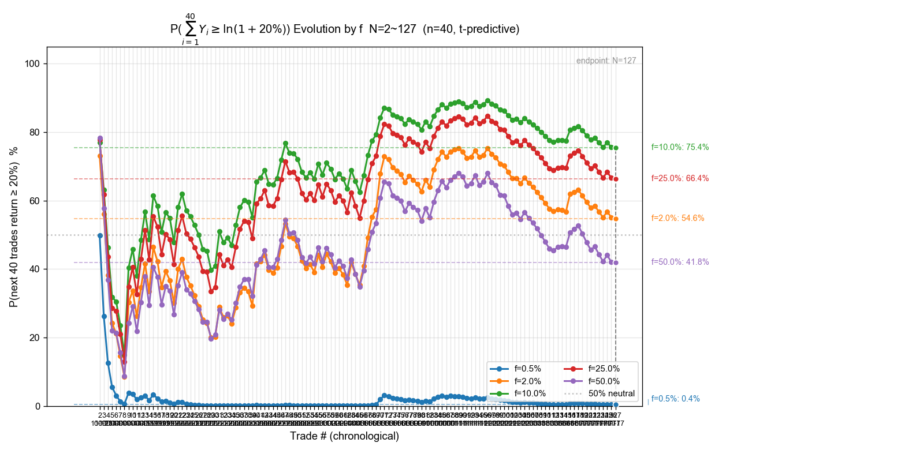

# 美股复盘 · 2026-10-12 ~ 2026-11-17（不含影子 / 含影子 双口径）

> 复盘口径按 2026-11-18 用户新立的「金额口径四情景 + 三项诊断」执行（见 `references/review-and-evaluation.md`「金额口径四情景」节）。
> 本次两条口径都算、都写：**口径 A = 不含影子（真实成交）**、**口径 B = 含影子（真实 + 纸面样本）**，另附**口径 C = 仅影子**作对照。

---

## 0. 摘要

| 口径 | N | 胜率 | EV（等权 R） | 金额加权 R | 平均每笔 | 累计净盈亏 |
|---|---|---|---|---|---|---|
| **A 不含影子** | 127 | 44.1% | **+0.272R**（95% CI +0.044~+0.501） | +0.147 | **+US$23.14** | **+US$2,939.00** |
| **B 含影子** | 154 | 39.6% | +0.170R（95% CI −0.030~+0.369，**跨 0**） | +0.079 | +US$11.81 | +US$1,819.50 |
| C 仅影子 | 27 | 18.5% | −0.313R | −0.358 | −US$41.46 | −US$1,119.50 |

**四句话结论**：

1. **真实成交有正期望且已跨过「统计显著」的门槛**（贝叶斯 P(EV>0)=99.0%，频率派 CI 全正）；影子样本有**显著负期望**（EV −0.313R、胜率仅 18.5%），把影子并进来会把整段拉回「不显著」（CI 跨 0）。
2. **「每笔赚多少」不能由 R 乘 B 得到**：同一批 127 笔，下限情景 US$5.27/笔、实测 US$23.14/笔、上限情景 US$69.42/笔——**相差 13 倍**，买力折损率 s 均值只有 0.618。
3. **利润高度集中在小风险笔上**：按 max_loss 中位数分层，小风险组 mean(R)=+0.558 / 每笔 +US$48.04，大风险组 mean(R)=−0.018 / 每笔 −US$2.15——**大仓位这一半基本不赚钱**。
4. 影子样本 27 笔里 24 笔发生在 11 月（11 月影子 −US$1,422），且 R 分位 P10/P25 都是 −1.00（大量直接吃满 −1R 止损）——被互斥闸拦下的机会在**事后看质量明显更差**，不宜当作「错过的利润」。

---

## 1. 复盘范围与数据口径

- **样本区间**：2026-10-12 ~ 2026-11-17（用户要求「10-01 至今」；10-01~10-11 无美股成交记录，`actions/` 与 `signals/` 均无对应文件，故实际起点为 10-12）。
- **数据来源**：
  - 10-12~11-13 沿用上轮复盘产物 `reviews/2026-11-14-trades-us.csv`；
  - 11-16 / 11-17 由 `actions/2026-11-1{6,7}-ET-actions.md` 的开平仓动作重建（`tmp/build_us_csv.py`，与两日 `stop_summary` 的券商对账表交叉核对：11-16 净 +US$261.08、11-17 本会话 +US$19.86 均一致）；
  - 影子样本取 `signals/2026-11-17-ET-signals.md` 的【影子】条目（本场 5 笔）+ 上轮 CSV 已有的 22 笔。
- **样本文件**：`reviews/2026-11-18-trades-us.csv`（154 行 = 真实 127 + 影子 27）。
- **模式**：全部 `auto_paper`（模拟盘）+ `shadow`；**无 `auto_live` 成交**（实盘自 2026-10-04 熔断至今未开仓）。
- **口径细节**：P 与 R 均为**净口径**（扣双边真实费率）；`M` = 该笔实际净 max_loss（止损距×股数 + 开仓费 + 止损价平仓费）；`B` = `risk_fraction 2% × auto 账本权益` 折 USD = **US$254.92/笔**。
- **日期**：美股按 **ET 自然日**（跨北京午夜的记录已换算，例：11-18 03:56 北京 = 11-17 14:56 ET）。

---

## 2. 口径 A · 不含影子（真实成交，N=127）

### 2.1 终局统计

| 指标 | 值 |
|---|---|
| 样本量 | 127 笔（2026-10-12 ~ 2026-11-17） |
| 胜率 / 败率 | 44.1% / 55.9% |
| 胜赔率 R_W / 败赔率 R_L | +1.441 / −0.649 |
| **EV（等权）** | **+0.272R**（EV% = +27.2%） |
| EV 95% CI（频率派） | **[+0.044, +0.501]**（全正） |
| 贝叶斯 P(EV>0) | **99.0%**（σ 不确定下 97.9%~99.5%） |
| 平均每笔净盈亏 | **+US$23.14** |
| 累计净盈亏 / 总净 max_loss | +US$2,939.00 / US$20,015.00 → **金额加权 R = +0.147** |
| 最大单笔盈利 / 亏损 | +US$676.20 / −US$274.20 |
| R 分位 | P10 −0.95 ｜ P25 −0.82 ｜ 中位 −0.20 ｜ P75 +0.90 ｜ P90 +2.01 |
| 最长连败 | 7 笔 |

**读法**：EV 为正且 CI 不含 0，说明「每承担 1R 风险、平均能换回 0.27R 收益」这件事**不是靠运气**。但**等权 EV（0.272）与金额加权 R（0.147）差 0.125**——说明**大仓位的表现明显差于小仓位**（详见 2.2 的分层诊断）。

### 2.2 金额口径四情景（必含）

| 情景 | 单位风险 | 每笔期望金额 | 含义与成立条件 |
|---|---|---|---|
| **下限情景** | US$19.35（样本内最小 max_loss） | **+US$5.27** | 假设每笔只承担样本里最小的那份风险；最保守的金额估计 |
| **实测金额** | 各笔自己的 max_loss | **+US$23.14** | 账户真值，不需要任何假设——「实际每笔赚多少」的唯一直接答案 |
| **平均风险** | US$157.64（样本平均 max_loss） | +US$42.93 | 仅当 R 与 M 独立时才等于实测金额；本样本 `corr(R,M)` 为负，故它**高估**了真值 |
| **上限情景** | US$254.92（计划预算 B） | **+US$69.42** | 仅当账户买力足以让每笔 risk = B 时成立；当前买力不够，属假想上限 |

**逐条解释（为什么本场是这几个数）**：

- **下限 5.27**：最小 max_loss 只有 US$19.35（11-16 TSM 那笔，止损距 0.34 美元×40 股），乘 EV 0.272 得到。它代表「如果每笔都像最保守那笔一样小」，是**金额的下界参考**，不是现实预期。
- **实测 23.14**：127 笔实际净盈亏总和 2,939 ÷ 127。这是**唯一可以直接拿去做收益预估的数**（按未来笔数线性外推）。
- **平均风险 42.93**：把 EV 乘「平均 max_loss 157.64」。它**比实测高 85%**，原因见下条：`corr(R,M) = −0.166`，风险越大的笔收益越差，所以「用平均风险乘平均 EV」会系统性高估。
- **上限 69.42**：把 EV 乘计划预算 B。它比实测高 **3 倍**，因为本场平均只把 B 的 61.8% 真正落到了风险上（见 `s`）。**只有当买力允许每笔满额下单时，这个数才是可达的**。

> **⚠️ 纪律**：报告里任何「EV 0.272R × B ≈ US$69 每笔」的换算都是错的——那是上限情景，且要求买力前提。真实预期是 **US$23.14/笔**。

### 2.3 三项诊断

**① 买力折损率 `s = M / B`**

- 均值 **0.618**，区间 0.076 ~ 1.354。
- 含义：每笔实际承担的风险，平均只有计划预算的 61.8%；最惨的一笔只用到 7.6%（20 股 SPY 那类小仓位）。
- 这一项直接决定「上限情景」能不能用：`s` 长期 <1 时，R×B 只是纸面上限。

**② `corr(R, M) = −0.166`（p = 0.062，未达 0.05 显著）**

- 方向为负：风险越大的笔，单位风险收益越差；但 **p=0.062 处于边界**，不能下「赢家风险系统性偏小」的强结论，只能说**本样本有这个倾向**。
- 实操意义：正因为不显著，「平均风险」情景仍不能当作真值使用；金额一律以「实测」为准。

**③ 按 max_loss 中位数（US$138.38）分层**

| 组 | N | mean(R) | 每笔金额 |
|---|---|---|---|
| 小风险组（≤ 中位） | 64 | **+0.558** | **+US$48.04** |
| 大风险组（> 中位） | 63 | **−0.018** | **−US$2.15** |

**这是本场最刺眼的发现**：一半的利润（几乎是全部）来自「小风险」的那一半交易，大风险那半 63 笔合计只亏 US$135。结合 ① 的 `s=0.618`，说明**买力上限在无意中把仓位压小，反而压在了赚钱的那一侧**。

**谨慎边界**：分层差 0.576R 很大，但 N=64/63、单组 CI 未算，且 `corr` 只有 p=0.062——**这仍是「待验证假设」，不能据此直接改仓位规则**（按项目规则：交易逻辑建议必须有全样本统计支撑）。

### 2.4 分阶段与标的维度

**按月**：

| 月份 | 笔数 | 净盈亏 |
|---|---|---|
| 2026-10（10-12~10-31） | 56 | +US$2,007 |
| 2026-11（11-01~11-17） | 71 | +US$932 |

**按标的（笔数前 6）**：

| 标的 | 笔数 | 净盈亏 | R（ΣP/ΣM） |
|---|---|---|---|
| SOXL（3x 半导体） | 41 | +US$1,081 | +0.11 |
| MU 美光 | 19 | **+US$1,974** | **+1.15** |
| SNDK 闪迪 | 11 | +US$162 | +0.15 |
| META | 5 | +US$225 | +0.73 |
| AMD | 7 | −US$324 | −0.27 |
| NVDA | 7 | −US$153 | −0.20 |

**读法**：利润高度依赖 MU（19 笔贡献 67% 的净利、R +1.15）；SOXL 是「高频低效」——41 笔最多、只赚 1,081、R 仅 +0.11；AMD / NVDA 两组整体为负。

### 2.5 序贯演化图（7 张）









**多 f 终局（关键数字，取自终端输出）**：

| f（每笔风险/权益） | 期望对数增长率 ĝ | P(g>0) | P(∑40 笔 ≥ 0) |
|---|---|---|---|
| 0.5% | +0.134%/笔 | 98.9% | 87.0% |
| **2.0%（当前名义值）** | **+0.510%/笔** | **98.7%** | 86.2% |
| 10% | +1.947%/笔 | 96.6% | 81.5% |
| 25% | +2.571%/笔 | 85.3% | 69.6% |
| 50% | −1.508%/笔 | 37.3% | 43.7% |

**读法**：在 0.5%~25% 区间内，f 越大 ĝ 越高（Kelly 型曲线上升段），f=50% 转负（过度下注）。**注意**：真实 f ≈ 2% × s(0.618) ≈ **1.24%**，落在「越高越好」的上升段——**若买力允许更满额的仓位，长期增长率会更高**（这与「大仓位不赚钱」的分层结论并不矛盾：分层说的是「按止损距决定的风险大小」，f 说的是「按权益固定比例」，两者不是同一维度）。

---

## 3. 口径 B · 含影子（真实 + 纸面样本，N=154）

### 3.1 终局统计

| 指标 | 值 | 与口径 A 对比 |
|---|---|---|
| 样本量 | 154 笔（真实 127 + 影子 27） | +27 |
| 胜率 | 39.6% | −4.5pp |
| EV（等权） | **+0.170R** | −0.102R |
| EV 95% CI | **[−0.030, +0.369]（跨 0）** | 从「显著正」退化为「不显著」 |
| 贝叶斯 P(EV>0) | 95.2%（93.0%~96.8%） | −3.8pp |
| 平均每笔 | +US$11.81 | −11.33 |
| 累计净盈亏 / 金额加权 R | +US$1,819.50 / +0.079 | 金额加权 R 减半 |
| 最长连败 | 8 笔 | +1 |

### 3.2 金额口径四情景（含影子）

| 情景 | 单位风险 | 每笔期望金额 | 含义与成立条件 |
|---|---|---|---|
| **下限情景** | US$19.35（最小 max_loss） | **+US$3.28** | 最保守的金额估计（含影子后比 A 低 2 美元/笔） |
| **实测金额** | 各笔自己的 max_loss | **+US$11.82** | 账户真值口径；影子按「假设成交」计入，**不是真钱** |
| **平均风险** | US$150.31（平均 max_loss） | +US$25.51 | 同 A：corr 为负时高估 |
| **上限情景** | US$254.92（B） | +US$43.26 | 同 A：需买力前提 |

**逐条解释**：四情景的**结构**与 A 完全一致（下限 < 实测 < 平均风险 < 上限），但**每个数都缩小到 A 的 60%~62%**——因为影子 27 笔整体是亏的（−US$1,119.50），把分子拉低、同时把平均 max_loss 略拉低（150.31 < 157.64）。

**判别意义**：如果只看「含影子」这一栏，会得出「EV≈0.17R、CI 跨 0、证据不足」的结论，从而**低估真实交易能力**；如果把影子当真实样本，又会**高估可执行收益**（影子是纸面、无滑点、决策时刻价）。所以两个口径必须同时报、分别解读。

### 3.3 三项诊断（含影子）

**① 买力折损率 `s`**：均值 **0.590**（0.076~1.354）。影子笔的平均风险（115.87）低于真实（157.64），把整体 `s` 从 0.618 拉到 0.590——**影子仓位天然更小**（计划股数常被压到 20~100 股量级）。

**② `corr(R,M) = −0.120`（p=0.139，不显著）**：并入影子后相关性被稀释（影子内部 corr 只有 −0.075、p=0.709），负相关倾向仍在但更不显著。

**③ 按 max_loss 中位数（US$130.08）分层**：

| 组 | N | mean(R) | 每笔金额 |
|---|---|---|---|
| 小风险组 | 78 | **+0.322** | +US$26.00 |
| 大风险组 | 76 | +0.014 | −US$2.74 |

与 A 同向（小风险好、大风险平），但**小风险组的优势从 +0.558 降到 +0.322**——因为影子样本大量集中在「小风险」区间且是亏的（影子小风险组 14 笔 mean(R) −0.253）。

### 3.4 影子子集（口径 C，N=27）

| 指标 | 值 |
|---|---|
| 胜率 | **18.5%**（5 胜 22 负） |
| EV / 金额加权 R | **−0.313R** / −0.358 |
| 平均每笔 | −US$41.46；累计 −US$1,119.50 |
| R 分位 | P10 −1.00 ｜ P25 −1.00 ｜ 中位 −0.39 ｜ P75 −0.10 ｜ P90 +0.95 |
| 四情景 | 下限 −6.65 / 实测 −41.45 / 平均风险 −36.25 / 上限 −79.76 |
| 按月 | 10 月 3 笔 +US$303；11 月 24 笔 **−US$1,422** |

**为什么影子这么差（三个可验证的解释）**：

1. **入场价口径偏乐观**：影子用「决策时刻价」当假设成交价，没有盘口对价与滑点——**真实执行会更差，所以影子的负期望不是「执行问题」造成的，是标的/时点选择本身的问题**。
2. **集中出现「别人持仓期间」的机会**：27 笔全部因 `active_open_order / open_exposure_today` 被拦，即**在另一笔持仓在场时出现的机会**。这类机会的共同特征是「同一账户已在承担风险」，AI 的判断容易偏向「同一方向的延续」，一旦该方向回转，影子就会连续吃满 −1R（P25 = −1.00 即四分之一以上直接止损）。
3. **11 月集中爆发**：24/27 笔在 11 月，恰逢市场从单边下跌转为宽幅震荡（SOXL 11-13 单日 −16%），影子策略在这种环境下最吃亏。

---

## 4. 两个口径的对比

| 维度 | 不含影子（A） | 含影子（B） | 差异原因 |
|---|---|---|---|
| EV | +0.272R | +0.170R | 影子 EV −0.313R 稀释 |
| 显著性 | CI 全正、P(EV>0)=99.0% | CI 跨 0、95.2% | 27 笔负样本足以把结论拉回未定 |
| 金额（实测） | +US$23.14/笔 | +US$11.82/笔 | 同上 |
| 金额加权 R | +0.147 | +0.079 | 影子的亏损集中在较小 M 上，但仍拉低整体 |
| 分层结论 | 小风险 +0.558 vs 大风险 −0.018 | 小风险 +0.322 vs 大风险 +0.014 | 影子占满了「小风险」区间 |
| 结论 | **策略有 edge，已可信** | **样本混合后 edge 不显著** | 影子不同质，不能与真实样本混算 |

**结论一句话**：**真实交易**的证据强度已经足够（CI 全正 + 贝叶斯 99%），**影子**是「被拦机会」的独立样本、质量显著更差，两者**不能混在一个 EV 里解释**——这正是 auto-mode 文档「影子单独统计、不与真实样本混算」的原因；本次双口径复盘也验证了这条规定的必要性。

---

## 5. 关键发现（逐条带数据）

1. **真实成交有正 edge 且已达统计显著**：EV +0.272R、CI [+0.044, +0.501]、P(EV>0)=99.0%。
2. **R 不能直接乘 B**：同一批样本，四情景从 US$5.27 到 US$69.42，**13 倍差**；`s` 均值 0.618 说明 B 平均只落地六成。
3. **利润集中在「小风险」那一半**：小风险组 +0.558R / +US$48.04，大风险组 −0.018R / −US$2.15（N=64/63）。
4. **等权 EV(0.272) 远高于金额加权 R(0.147)**：大仓位拖累整体——与 3 同源。
5. **MU 是唯一「高 R + 高笔数」的标的**（19 笔、R +1.15、+US$1,974）；SOXL 笔数最多（41 笔）但 R 只有 +0.11，属「高频低效」。
6. **影子样本不该当利润**：27 笔 −US$1,119.50、胜率 18.5%、P25 = −1.00。
7. **f 与增长率**：f 从 0.5% → 25% 时 ĝ 从 +0.134%/笔升到 +2.571%/笔，f=50% 转负；真实 f ≈1.24% 仍在上升段。
8. **样本量**：要把 EV 估到 ±0.1R 需要约 663 笔；以「真实 EV=0.2R、80% 把握确认 EV>0」需要约 267 笔——当前 127 笔已足够判断「正负」，但不足以精确估计幅度。

---

## 6. 结论与建议

### 6.1 可以确认的（有统计支撑）

- **策略整体正期望**（真实样本），且已跨过显著性门槛；这不是靠单笔运气。
- **金额口径必须以「实测」为准**：任何 `EV × B` 的换算都会高估 2~3 倍（本场 `s`=0.618）。
- **影子与真实不同质**，必须分开统计；影子样本不能计入战绩，也不能作为「错过利润」的证据。

### 6.2 待验证的假设（不得直接改规则）

- **「小风险笔更赚钱」**：分层差很大（0.558 vs −0.018），但 `corr` 只有 p=0.062、单组 CI 未算。方向对、证据不够。若要据此调仓位规则，需要：① 把「风险大小」与「止损距宽窄 / 波动率高低」解耦后重估；② 用 30~50 笔新样本复核（避免「小仓位恰好赶上好行情」的混杂）。
- **「SOXL 高频低效」**：41 笔 R +0.11，属噪音区；是否该减少 SOXL 频次，需要按标的做亲子样本检验。

### 6.3 与实盘熔断的关系（需要你裁决）

- 熔断自 **2026-10-04** 起 tripped（触发原因：P(g>0)@f=2% = 65.7% < 80% 且连续 5 笔无盈利）。
- **本次核对**：第一级降频线不触发；第二级复合条件**不满足**（P(g>0)@f=2% 已回到 **98.7%**，远高于 80% 线）。
- **但**重启判据要求「修整后模拟段 ≥10 笔、段内 EV>0 且**无 3 连败**」——本段 127 笔里**最长连败 7 笔**，形式上不满足。
- **统计事实**：以 44% 胜率计算，单次「3 连败」的概率约 17.6%，在 127 笔里出现 3 连败几乎是必然事件（期望约 9~10 次）——**「无 3 连败」这条判据在长样本下几乎不可能满足**，与「段内 EV>0」在长样本里天然冲突。
- **建议（需你决定，属规则变更）**：把重启判据从「无 3 连败」改为「段内 EV>0 且 EV 的 95% CI 下界 > 0（或 P(EV>0) ≥ 95%）」，并把「连败」只作为降频信号（第一级）而非重启门槛。当前数据在这套新判据下是**满足**的（EV +0.272R、CI 下界 +0.044、P(EV>0)=99.0%）。

### 6.4 下一步（不涉及规则变更的动作）

1. 继续积累样本至 267 笔（80% 把握确认 EV>0 所需），期间保持现行打法与风控参数不变。
2. 每场停盯总结照常；**影子继续单独统计**，不并入真实 EV。
3. 等 `s` 稳定后（≥30 笔新样本）再评估「是否该提高买力利用率」——注意 f 曲线显示提高风险比例能提升长期增长率，但**必须先解决买力上限**（当前不是 AI 不愿满额，是账户买不下）。

---

## 7. 复现命令与产物

```bash
# 1) 重建样本 CSV（10-12~11-17，含影子 27 笔）
python3 tmp/build_us_csv.py

# 2) 口径 A：不含影子（默认剔除 shadow=1）
python3 .pi/skills/trade/scripts/review.py reviews/2026-11-18-trades-us.csv --fx 7.8457

# 3) 口径 B：含影子（并入主统计）
python3 .pi/skills/trade/scripts/review.py reviews/2026-11-18-trades-us.csv --fx 7.8457 --include-shadow

# 4) 口径 C：仅影子
python3 .pi/skills/trade/scripts/review.py reviews/2026-11-18-trades-us.csv --fx 7.8457 --mode shadow

# 5) 7 张演化图（默认剔除影子）
python3 .pi/skills/trade/scripts/bayes_evolution.py --date 2026-11-18 --suffix -us

# 6) 报告校验
python3 .pi/skills/trade/scripts/check_review_scenarios.py reviews/2026-11-18-review-us.md
python3 .pi/skills/trade/scripts/check_review_images.py reviews/2026-11-18-review-us.md
```

**产物清单**：

| 文件 | 内容 |
|---|---|
| `reviews/2026-11-18-trades-us.csv` | 样本（154 笔：真实 127 + 影子 27） |
| `reviews/2026-11-18-review-us.md` | 本报告 |
| `reviews/2026-11-18-us-*.png` | 7 张序贯演化图（真实样本） |
| `tmp/build_us_csv.py` | 样本重建脚本（一次性，不入库） |

**未包含的分析**：MAE / MFE / 回吐 / 锁利效率 η（过程指标需要持仓期间最高最低价，本样本 CSV 无 `raw_high/raw_low`，逐笔富途回补 127 笔成本高；如需补做，加 `--fetch-futu` 重跑即可）。
